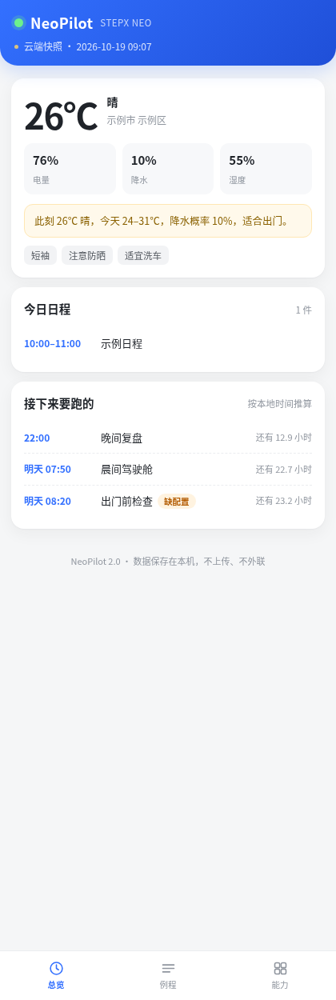
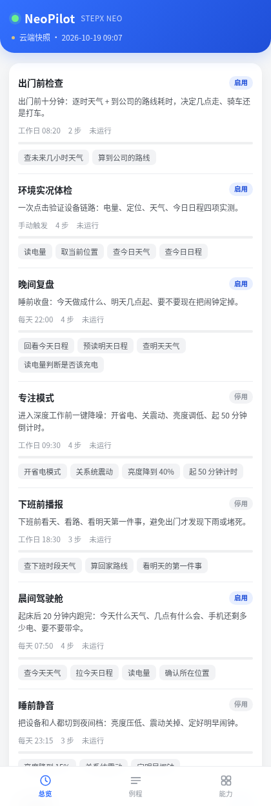
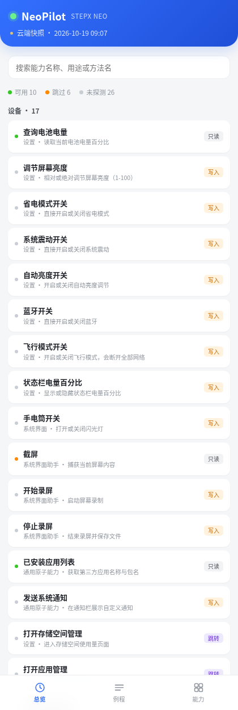

# NeoPilot

**把 STEPX Neo 上的 42 个原子能力编成可定时、可重试、可审计的例程，并给它们一个手机端驾驶舱。**

<p>



</p>

一句话：以前每次都要重新说一遍的事，现在写一次，之后它自己跑。

> 仓库内所有示例数据均为虚构（示例市 / 示例日程）。真实位置、日程、相册路径、运行记录、签名密钥一律未入库。

## 快速开始

```bash
git clone https://github.com/zachshi-ai/neopilot.git
cd neopilot
python3 neopilot.py init
python3 neopilot.py seed
python3 neopilot.py doctor
python3 neopilot.py dashboard   # 生成单文件驾驶舱
```

打 APK 需要 JDK 17 + Android SDK（build-tools 34、platform android-34）：

```bash
export ANDROID_SDK=/path/to/android-sdk
./build.sh        # 自检 → 单测 → 驾驶舱 → 站点 → APK → 快照
```

## 它解决什么

手机上的能力是**原子**的：查天气、读电量、翻日程、算路线、调亮度、发通知，每件都能一句话完成，但每件都要你开口一次。一天里真正重复发生的，恰恰是这十几件小事。

NeoPilot 补的是中间那层**编排**。

| 层 | 内容 |
|---|---|
| 原子能力层 | 42 个 method，覆盖设备 / 日程 / 位置 / 媒体 / 通信 |
| **编排层** | 例程、时间表、步骤状态机、重试、验收、简报 |
| 交付层 | 手机 App（原生壳 + 本地采集）、单文件驾驶舱、人话简报 |

---


把 STEPX Neo 上 42 个原子能力编成**可定时、可重试、可审计**的例程，并给它们一个手机端的驾驶舱。

一句话：**以前每次都要重新说一遍的事，现在写一次，之后它自己跑。**

---

## 架构（2.0 重构后）

```
┌─────────────────────────────────────────────────────────┐
│  neopilot/          引擎（纯逻辑，不碰设备）              │
│    catalog.py   42 个能力的结构化目录                     │
│    presets.py   9 条预置例程                             │
│    engine.py    模板 / 状态机 / cron / 健康度             │
│    store.py     JSON 原子写入                            │
│    brief.py     运行结果 → 人话                          │
│    state.py     ★ 唯一数据契约（三源归一）                │
│    web.py       骨架装配                                │
│    cli.py       命令行                                   │
├─────────────────────────────────────────────────────────┤
│  web/               前端（唯一渲染逻辑）                  │
│    index.html   骨架 + 底部导航                          │
│    styles.css   飞书蓝、移动优先                          │
│    app.js       从 JSON 渲染全部页面                      │
├─────────────────────────────────────────────────────────┤
│  android/           原生壳                               │
│    MainActivity 全屏 WebView + 只读桥接                   │
│    LocalProbe   本机采集（电量/定位/天气/日程）            │
└─────────────────────────────────────────────────────────┘
```

**一条数据流，三个来源，一个形状：**

```
云端存储 ─┐
本机采集 ─┼→ state.py 归一 → {meta, today, engine, caps} → app.js 渲染
构建内联 ─┘
```

---

## 2.0 修掉的四个架构债

**① 渲染双轨 → 单轨**
1.x 里 Python 先渲染一遍静态 HTML，JS 再逐字段覆写。加一个字段要改两处
（`render.py` 加 id + 桥接脚本加 `setText`），字段一多就失控。
现在 Python 只产出 JSON，页面结构全部由 `app.js` 生成，**加字段只改一处**。

**② 数据契约不统一 → 一个形状**
本地采集、云端快照、构建内联三种来源字段名各写各的，前端要写三套兜底。
现在全部经 `state.py` 归一成同一份契约，前端只写一次。

**③ 职责错位 → 分层**
`render.py` 原来 483 行，HTML、CSS、JS、数据全在里面，还叠了 7 个补丁脚本。
现在它是 20 行胶水，结构在 `web/`，数据在 `state.py`，各归各位。

**④ 实时性走错路 → 本地采集**
1.x 靠云端每 4 小时推一次快照。但电量、日程、位置本来就是本机可读的，
绕去云端毫无必要。2.0 直接在 App 内采集，打开即当下，云端快照降级为兜底。

---

## 数据来源与降级

| 数据 | 来源 | 权限 | 实时性 |
|---|---|---|---|
| 电量 | `BatteryManager` | 无 | 秒级 |
| 位置 | `LocationManager` | ACCESS_COARSE_LOCATION | 秒级 |
| 天气 | open-meteo（免密钥） | INTERNET | 分钟级 |
| 日程 | `CalendarContract` | READ_CALENDAR | 秒级 |
| 例程状态 | 云端快照 | — | 4 小时 |

三级降级：**本机实时 → 云端快照 → 打包内联**。任何一级失败都不白屏。

---

## 命令

```bash
python3 neopilot.py init          # 初始化
python3 neopilot.py seed          # 写入 9 条预置例程
python3 neopilot.py doctor        # 体检
python3 neopilot.py routines      # 例程列表
python3 neopilot.py due --window 15   # 到点了吗（只看不动）
python3 neopilot.py tick          # 到点就启动
python3 neopilot.py crontab       # 输出可安装的调度行
python3 neopilot.py run env-probe     # 起一次运行
python3 neopilot.py brief <run_id>    # 出人话简报
python3 neopilot.py snapshot      # 生成 App 快照
python3 neopilot.py dashboard     # 生成单文件 HTML
```

构建：

```bash
python3 build_site.py    # → site/（PWA）
./build_apk.sh           # → NeoPilot.apk
python3 -m unittest -v test_neopilot
```

---

## 预置例程

| ID | 名称 | 时间表 |
|---|---|---|
| `morning-cockpit` | 晨间驾驶舱 | 每天 07:50 |
| `commute-ready` | 出门前检查 | 工作日 08:20 |
| `evening-review` | 晚间复盘 | 每天 22:00 |
| `focus-block` | 专注模式 | 工作日 09:30 |
| `leave-work` | 下班前播报 | 工作日 18:30 |
| `sleep-mode` | 睡前静音 | 每天 23:15 |
| `travel-day` | 出行日包 | 手动 |
| `weekly-archive` | 周度归档 | 周日 20:00 |
| `env-probe` | 环境实况体检 | 手动 |

带外部地址的例程需要先补变量：

```bash
python3 neopilot.py run commute-ready --ctx city=示例市 home_work_gcj=116.40,39.90
```

---

## 2.1 补齐的八件事

| # | 原来 | 现在 |
|---|---|---|
| 1 | cron 唤起会话用自然语言重跑，绕开引擎 | `tick --claim` 起跑 → `work` 出待办队列 → 逐条执行回填 → `brief` 出简报，**引擎状态机真正生效** |
| 2 | App 拿不到例程状态，待跑列表滞后 4 小时 | 例程定义（含 cron）内联进 App，**前端本地算下次运行时间**，待跑列表实时 |
| 3 | 能力目录是静态清单，不知道能不能用 | `probe` 实测：10 项只读可用、6 项跳过、26 项未探测，App 里用状态点+图例展示 |
| 4 | 写操作无痕 | `report` 时自动落 `audit.jsonl`，write/navigate 一律留痕（含失败），`audit` 可查 |
| 5 | 周度归档只有定义没跑过 | 实跑通过，并发现 `gallery_create_album` 会拉起相册界面（10402），已降级为可选步骤 |

整合的三处：

1. **cron → 引擎**：三条定时任务的指令全部改成「tick → 按 queue 执行 → report → brief」。
2. **合并策略显式化**：`meta.merge_policy = {today: local-first, engine: cloud-only}`，写进契约而不是散在代码里。
3. **一条命令构建**：`./build.sh` 依次完成自检 → 单测 → 驾驶舱 → 站点 → APK → 快照。

### 能力探测的边界（实测定论）

- **只探测只读能力**。`write` / `navigate` 会改设备状态或跳走页面，不自动巡检。
- **出卡类不探测**：高德的路线卡/概览卡/公交方案/多点标图、相册语义搜索，调用会在用户眼前弹卡片，标为 skip。
- **截屏跳过**：会产生文件副作用。
- 探测结果 7 天过期，`probe --queue` 自动列出需要重测的。

## 设计取舍

- **引擎不调设备**。它只推进状态机，能力调用交给执行方。同一份例程云端能跑、端侧也能跑，断了能续。
- **简报不调模型**。纯规则拼装，离线、确定、可复现。
- **桥接只读**。`getLive()` / `getData()` / `getMeta()` 三个方法，不给写、不给执行。
- **落点选 App 私有目录**。不申请 `MANAGE_EXTERNAL_STORAGE` 这类敏感权限。
- **失败不静默降级**。一步挂了就是挂了，错要错得看得见。

## 已知边界

- `content://com.android.calendar/instances/when` 是通用 URI，个别机型可能取不到日程。
- 天气用 open-meteo，境外服务，弱网时会退回云端快照。
- 例程状态（待跑/运行记录）仍依赖云端推送，App 本地拿不到。
